# ArchTune

**Architecture-aware pre-compilation pruning for Triton / `torch.compile` autotuning, built on a model of
ptxas register allocation.**

`torch.compile` (in `max-autotune` mode) and `triton.autotune` find the fastest GPU kernel by *compiling and
benchmarking every candidate configuration*. Compilation dominates that cost, and many candidates are doomed:
they **spill registers** or **overflow shared memory**, which the compiler only reveals *after* the work is done.
ArchTune prunes those outcomes **before compiling** and only compiles a short, ranked list.

<p align="center">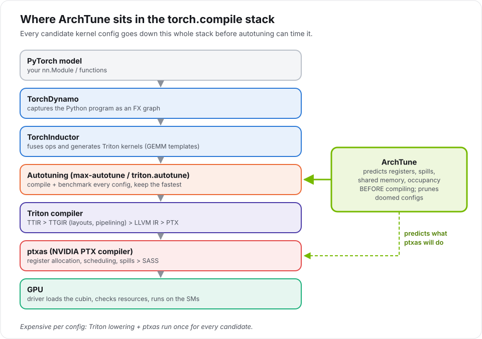</p>

## Summary of results

<!-- RESULTS:BEGIN (generated by archtune.report; do not edit) -->

| Result | Value |
|---|---|
| Live `triton.autotune` time, GEMM M4096 N4096 K4096 | **1,305 s → 5.6 s (232× less)**, chosen kernel +0.9% runtime |
| Exhaustive search's compile time spent on configs that spill or overflow shared memory | **94%**, the configs ArchTune prunes |
| Tuning cost to reach 95% of the best kernel, held-out shapes (median) | **11.6× lower** than random search |
| Shapes where ArchTune beats random search | **14 of 18** |
| Register prediction, non-spilling configs | median error **6** registers/thread |
| GPU | `rtx3050_sm86` (see Limitations) |

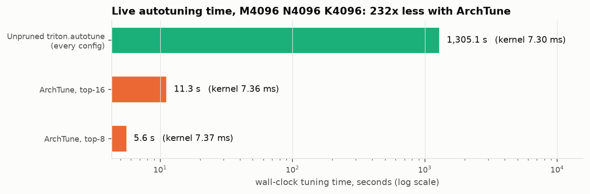

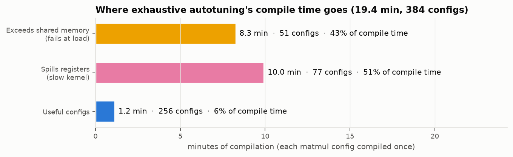

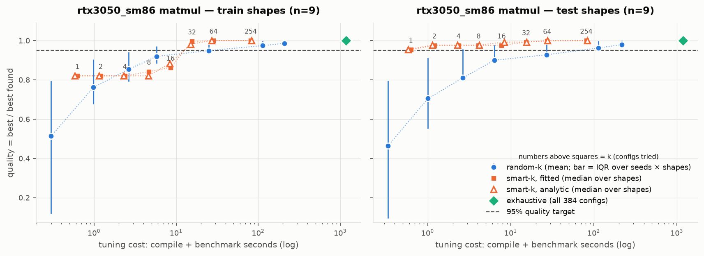


Full tables: [docs/RESULTS.md](docs/RESULTS.md).
<!-- RESULTS:END -->

Every number above is generated from `results/` by `python -m archtune.report`; none is typed by hand.
Readable write-up with deep dives: [docs/PROJECT_DOCUMENTATION.pdf](docs/PROJECT_DOCUMENTATION.pdf) ·
reproduce it: [SETUP.md](SETUP.md).

---

## 1. What is being optimized, and why

### The knobs autotuning chooses
A Triton matmul kernel is parameterized by its tile shape, warps and pipelining depth. Each choice trades
on-chip resources (registers, shared memory) against data reuse and parallelism, and the best trade-off
differs per GPU and per matrix shape, so there is no formula for it. That is why autotuners measure.

<p align="center">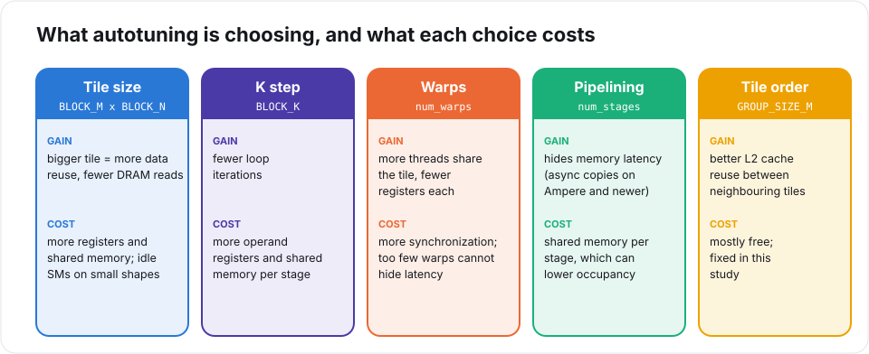</p>

### Why each candidate is expensive
Every config is a separate compile through the whole toolchain. The decisive step is **ptxas**, NVIDIA's
PTX-to-SASS compiler: it assigns physical registers (at most 255 per thread) and inserts spill code when they
run out. PTX itself has unlimited virtual registers, so **spills are invisible until ptxas runs**, and a config
that needs too much shared memory is only rejected when the driver loads the binary.

<p align="center">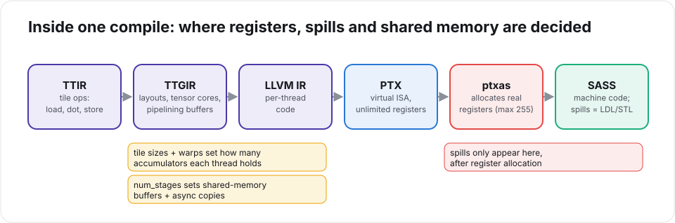</p>

The second chart in the summary above shows the consequence: in an exhaustive search, most of the compile
time is spent on exactly these doomed configs.

---

## 2. How ArchTune works

<p align="center">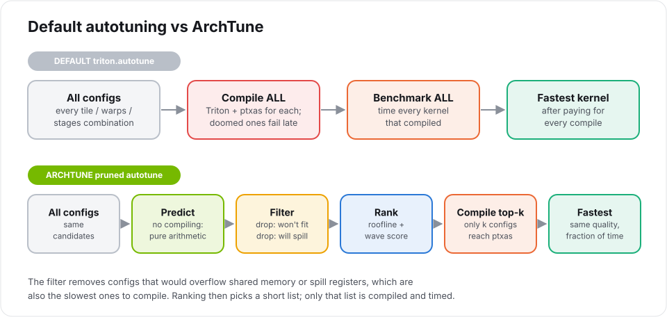</p>

The predictor is plain arithmetic over three inputs (the config, the problem shape and the GPU's limits).
It runs in milliseconds and plugs into Triton through `triton.autotune(prune_configs_by=...)`.

<p align="center">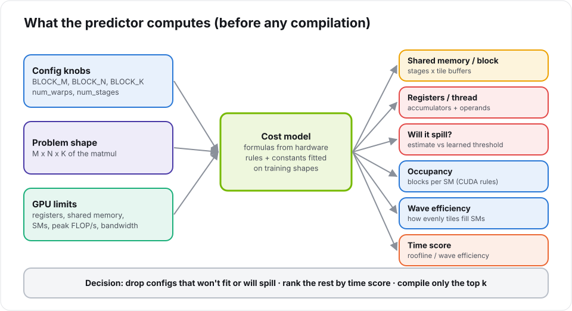</p>

| Prediction | How | Basis |
|---|---|---|
| Shared memory per block | (num_stages − 1) × (BM·BK + BK·BN) × 2 bytes on Ampere | software-pipelining buffers; variant selected from measured data |
| Registers per thread | a·accumulators + b·operands + s·pipelined operands + c | fp32 accumulator tile per thread; constants fitted (non-negative least squares) on training shapes |
| Will it spill? | register estimate above a learned threshold | ptxas's 255-register cap; threshold learned because ptxas packs large tiles to just under the cap |
| Occupancy | min(register, shared-memory, thread, block limits) | CUDA occupancy rules |
| Time score | max(FLOPs / peak, bytes / bandwidth) ÷ wave efficiency | roofline model + wave quantization |

Configs predicted to overflow shared memory or spill are dropped, the rest are ranked by the time score, and
only the top *k* are compiled and benchmarked. Hardware facts, fitted constants and hand-chosen design
constants are kept separate and documented in [docs/DECISIONS.md](docs/DECISIONS.md).

---

## 3. Results in pictures

**Search efficiency** is the third chart in the summary: each marker is a tuning budget *k*, and the further
left a strategy crosses the 95% line, the less tuning it needed (left: training shapes; right: held-out shapes).

**Predictor accuracy.** Predicted vs measured registers and shared memory, and spill prediction.

<p align="center">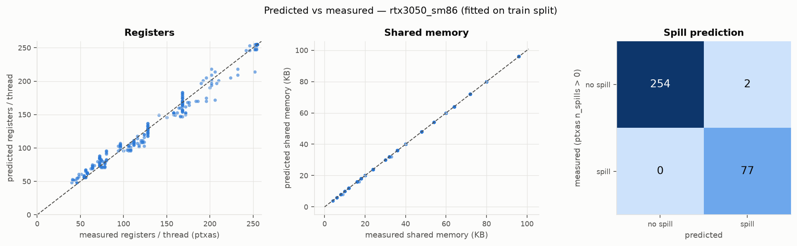</p>

**Register caps (`maxnreg`).** Capping registers can raise occupancy, but the resulting spills cost far more.

<p align="center">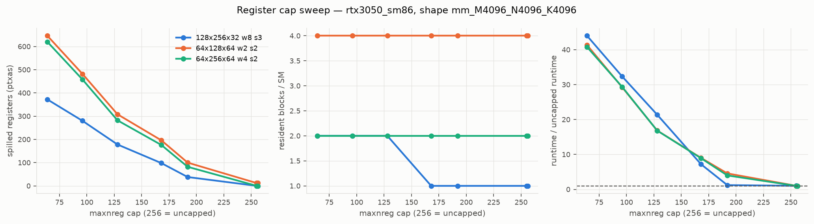</p>

**Pipelining depth (`num_stages`).** Shared memory and async copies grow with depth; runtime has a sweet spot.

<p align="center">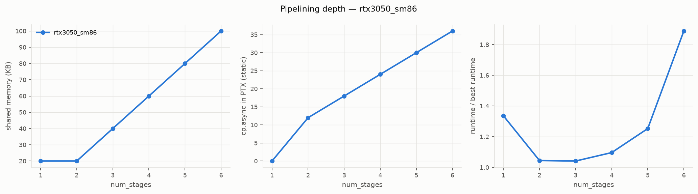</p>

**PTX liveness vs ptxas.** A PTX parser, CFG and liveness analysis written for this project estimates register
pressure before ptxas runs; it tracks ptxas's real allocation closely for kernels that fit, and kernels whose PTX
needs far more than 255 live values are exactly those ptxas spills.

<p align="center">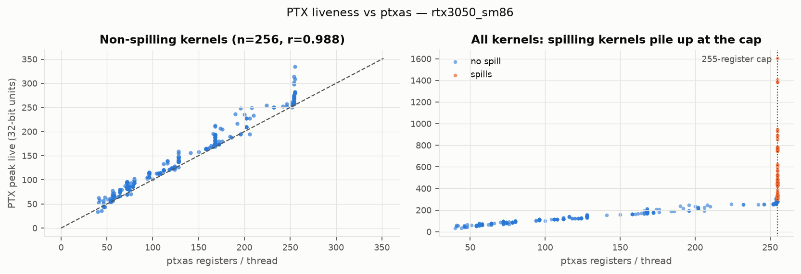</p>

---

## 4. Why it works (compiler evidence)

All numbers behind these statements are in [docs/RESULTS.md](docs/RESULTS.md); IR and assembly listings are
in `results/<gpu>/ir_exploration/`.

1. **Spills are a ptxas decision, invisible in Triton's PTX.** The slowest large-GEMM config has no
   `ld.local`/`st.local` in PTX but thousands of `LDL`/`STL` in SASS after register allocation. Spilling configs
   are both the slowest kernels and among the slowest to *compile*, so predicting them saves the most.
2. **ptxas packs large tiles just under the cap.** Many fast configs fit without spilling right below 255
   registers, so a spill rule at exactly 255 drops the fastest kernel; the fitted model learns its threshold.
3. **On Ampere, pipelining uses async copies and multi-buffered shared memory** (`cp.async` in PTX, `LDGSTS` in
   SASS). Configs over the shared-memory limit fail only when loaded; the predictor catches them up front.
4. **Pipelining depth has a sweet spot**: one stage has no async copies; a few stages hide memory latency; deep
   pipelines use so much shared memory that fewer blocks fit per SM.
5. **Register caps trade occupancy for spills, and lose**: the extra parallelism never pays for spill traffic.
6. **Where ArchTune loses**: its losses to random search cluster at the larger projections (M ≥ 512 with
   N ∈ {1600, 2560}) and decode-sized M. Possible causes (no L2-reuse term, coarse wave quantization on few SMs)
   are open.
7. **On a T4 (Turing), points 3–4 do not apply**: Triton 3.2 single-buffers shared memory there and
   `num_stages` has no effect ([DECISIONS D-022](docs/DECISIONS.md)), which is why the main run uses an Ampere GPU.

---

## 5. Limitations

- **The time score ranks coarsely.** Its rank correlation with measured runtime is low; the gains come mainly
  from exact feasibility filtering plus a performance landscape that is flat near the top.
- **Single laptop GPU** (RTX 3050, Ampere sm_86), not a data-center part; no cross-architecture evaluation
  (descoped, D-018). Peak throughput and bandwidth are estimated from clocks (D-023).
- Register and shared-memory accuracy is **in-sample over configs** (those properties do not depend on the shape).
- **No end-to-end `torch.compile` speedup is claimed.** ArchTune is measured in `triton.autotune`, the loop
  Inductor's GEMM autotuning is built on; Inductor itself skips max-autotune GEMM on GPUs with fewer than 68 SMs,
  and the Inductor hook is a feature-flagged prototype.
- RMSNorm's simple score does worse than random search.

---

## 6. Related work (no novelty is claimed over these)

| Work | Relation to ArchTune |
|---|---|
| Meta, [The Challenge of PyTorch 2.0 Compilation](https://pytorch.org/blog/experience-in-reducing-pt2-compilation-time-for-meta-internal-workloads/) | Autotune benchmarking was a large share of compile time and configs were pruned by hand; ArchTune automates pruning before compilation. |
| Ringlein et al., [GPU Performance Portability needs Autotuning](https://arxiv.org/pdf/2505.03780) | Tuning is expensive and configs do not transfer across GPUs, which is why per-GPU tuning (and cheaper tuning) matters. |
| [The Anatomy of a Triton Attention Kernel](https://arxiv.org/pdf/2511.11581) | Offline tuning distilled into decision trees (vLLM). |
| [IBM triton-dejavu](https://github.com/IBM/triton-dejavu) | Autotune result caching plus random / Bayesian search; complementary to pruning. |
| [tritonBLAS](https://arxiv.org/abs/2512.04226v1) | Analytical GEMM parameter selection that *replaces* tuning; ArchTune keeps tuning and only prunes. |
| Kuzmanov, [Kernel Tuner + Triton](https://theses.liacs.nl/pdf/2024-2025-KuzmanovAAndrija.pdf) | Search strategies for Triton tuning. |
| Hochgraf, [autotuning cost characterization](https://www.cs.rochester.edu/~spai4/courses/csc-290-571/fall-2024/static/final-reports/ML_Sys_Project_Report_RH.pdf) | Parallel compilation and cache-clearing overhead. |
| PyTorch Inductor "skip triton.Config that spills" | Post-compile spill filter; ArchTune moves the filter before compilation. |
| TTX (ISPASS 2026), XGBoost latency prediction for Triton | Learned latency models; ArchTune's predictor is analytical with a small fitted correction. |
| [Triton autotune API](https://triton-lang.org/main/python-api/generated/triton.autotune.html) | The `prune_configs_by` hook ArchTune implements. |

---

## 7. Reproduce

Step-by-step instructions (laptop GPU under WSL2, or Google Colab): **[SETUP.md](SETUP.md)**.

```bash
python -m archtune.preflight --out results_preflight   # 16 checks of every GPU code path
python scripts/run_pipeline_local.py --mini            # quick end-to-end check
python scripts/run_pipeline_local.py                   # full run
python -m archtune.report                              # regenerate README numbers, RESULTS.md, figures
```

## Repository map

| Path | What it is |
|---|---|
| `archtune/predict.py` | cost model: shared memory, registers, spills, occupancy, waves, roofline score |
| `archtune/sweep.py` · `archtune/search.py` | resumable exhaustive sweep · replay of exhaustive / random-k / smart-k |
| `archtune/triton_hook.py` · `archtune/inductor_patch.py` | `prune_configs_by` integration · feature-flagged Inductor prototype |
| `archtune/ptx/` | PTX parser, CFG, liveness analysis |
| `archtune/preflight.py` · `archtune/pipeline.py` | pre-run checks · one function per project phase |
| `archtune/report.py` · `archtune/facts.py` | generated README block, RESULTS.md, figures, documentation numbers |
| `notebooks/ArchTune_Colab.ipynb` | the whole project in one Colab notebook |
| `docs/` | [DECISIONS.md](docs/DECISIONS.md) (every deviation and finding), [RESULTS.md](docs/RESULTS.md), [COLAB_GUIDE.md](docs/COLAB_GUIDE.md), PDF write-up |
| `scripts/` | local pipeline runner, diagram and document generators |

Diagrams are drawn by `scripts/make_diagrams.py`; result charts by `python -m archtune.report`.
